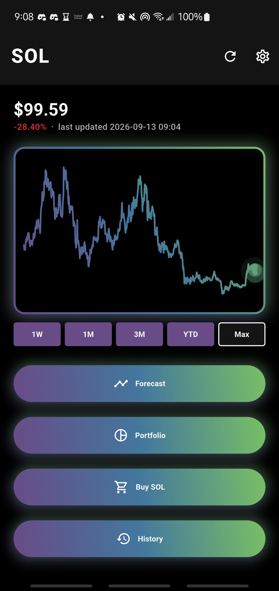

# [Solana Soothsayer](https://github.com/matthewthomasbeck/hackwestx) (Winner of Solana Track HackWesTX 2026)
### By [Matthew Thomas Beck](https://www.linkedin.com/in/matthewthomasbeck/)

Click [here](https://devpost.com/software/solana-soothsayer) for the Devpost

**Please consider:** if you like it, **star it!**

## Tech Stack
- **Languages:** *Dart, Python*
- **Frontend:** *Flutter, Auth0 Flutter SDK (`auth0_flutter`), http*
- **Application Backend:** *Flask, Gunicorn, flask-cors, yfinance, pandas, NumPy, psycopg, PyJWT*
- **Predictor Backend:** *Flask, Gunicorn, PyTorch (BiGRU + temporal attention), NumPy, scikit-learn, PyJWT*
- **Data & Auth:** *Tiger Cloud / TimescaleDB, Auth0 (Universal Login + M2M)*
- **Infra:** *AWS EC2, Tailscale, CUDA GPU*

## Overview
Solana Soothsayer is a Flutter trading companion that forecasts Solana (SOL) daily closes with a deep-learning time-series model, stores market history in a timeseries database, and lets you paper-trade against those forecasts without risking real money.

  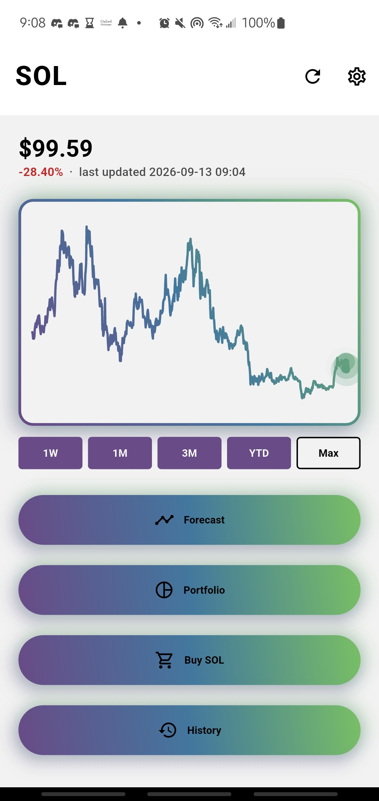
  

Crypto prices move fast and intuition alone is a bad trading strategy. I wanted a single app that answers two questions at once: where might SOL go next, and what would I do with that signal if I could practice without losing my net worth? HackWesTX's sponsor tracks (Auth0, Tiger Data, Solana, UI/UX) lined up with that idea: secure identity, efficient timeseries storage, Solana market context, and a mobile experience that feels like a real trading product.

  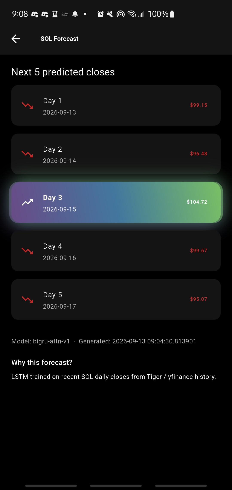
  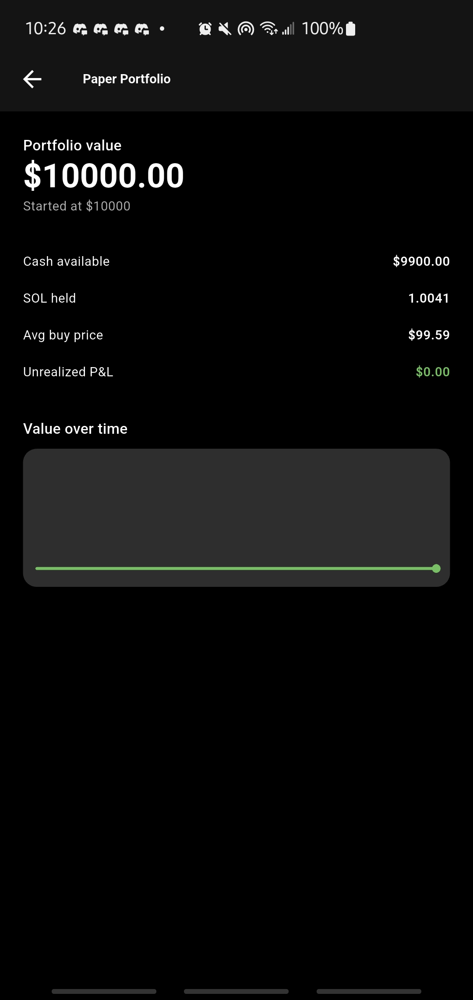

What resulted was three separate systems that talk to one another with a shared mission to serve the user: the application frontend, the application backend, and a customized predictor API for GPU compute.

## Application Frontend (Flutter)
The mobile client for iOS and Android. It handles Auth0 login, charts, forecast detail, paper buys, portfolio, and trade history. It never talks to the GPU machine directly — it only calls the application backend and polls market status (`empty`, `predictions_pending`, or `ready`) until forecasts land.

  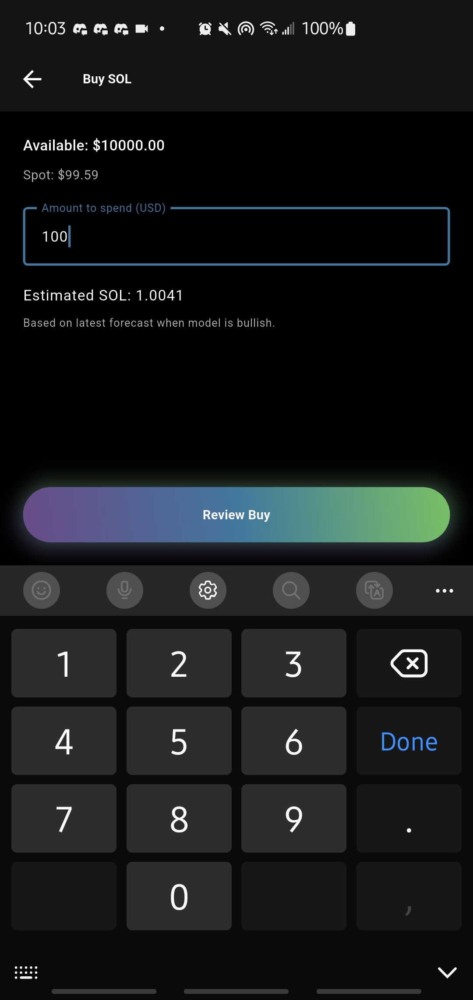
  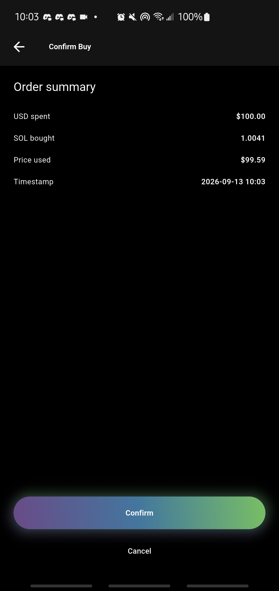

From amount entry through confirm and receipt, the paper-trade flow is meant to feel like a real order ticket — just without the real money.

  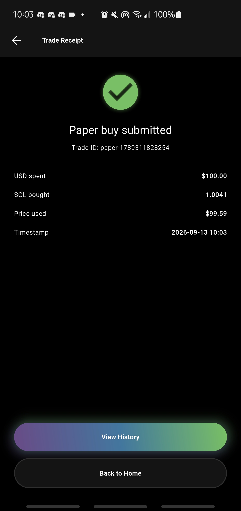
  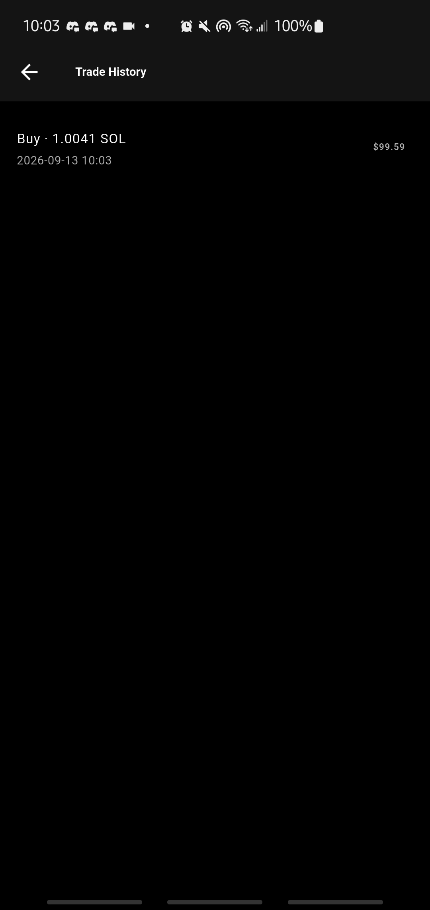

Light and dark themes, account reset, and Auth0 logout live in settings so the app stays usable as a day-to-day practice tool.

  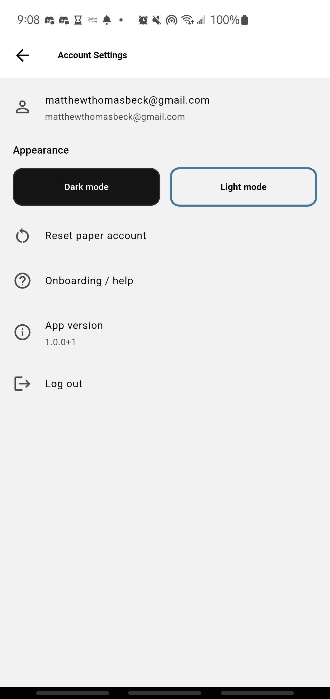
  

## Application Backend (EC2 + Flask)
The orchestrator in the middle. It verifies user JWTs from Auth0, pulls SOL-USD history with yfinance, reads and writes Tiger Data hypertables, decides whether the day is stale enough to refresh, and owns the pipeline that kicks off prediction jobs. When forecasts finish, it accepts a callback, stores the results, and serves a market bundle the Flutter app can render.

  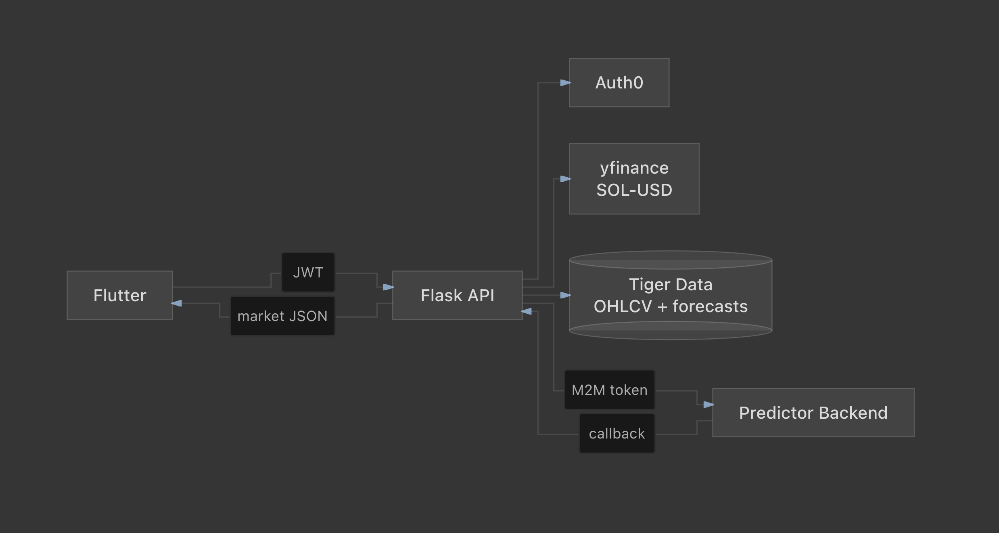

## Predictor Backend (Custom ML Predictor API)
I designed and built my own ML prediction API from scratch instead of plugging into a third-party forecasting SaaS. It is a Flask + PyTorch service that runs on my desktop GPU, joined to EC2 over Tailscale so inference stays on a private mesh with no home-network port forwarding.

That API defines its own request and response contract: accept timeseries JSON, queue async inference, run a BiGRU + temporal attention model, and POST forecasts back to the application backend callback. Auth0 machine-to-machine tokens gate every call so random clients cannot hit the GPU. The model, training/inference workers, auth, and callback flow are all custom code I wrote for this project.

  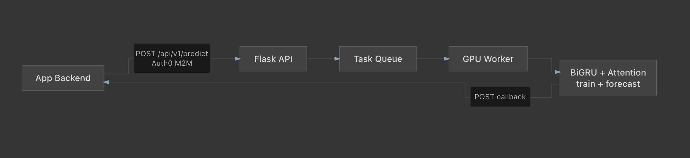

